# E.A.S.Y ABACA – Admin (MAO) User Manual

Para sa **MAO Super Admin / Coordinators** ng MAO Culiram. Lahat ng screenshot ay galing sa totoong admin portal (`/mao`).

> [!NOTE]
> Ang mga numero at pangalan sa screenshots ay data sa system noong kinunan ito at magbabago habang may bagong records.

## Talaan ng Nilalaman
1. [Pag-login](#1-pag-login)
2. [Pag-kilala sa Screen](#2-pag-kilala-sa-screen)
3. [Overview (Dashboard)](#3-overview-dashboard)
4. [Field Operations](#4-field-operations)
5. [Market & Logistics](#5-market--logistics)
6. [Administration (Super Admin lang)](#6-administration-super-admin-lang)
7. [Mga Action Buttons](#7-mga-action-buttons)
8. [Tips at Troubleshooting](#8-tips-at-troubleshooting)

---

## 1. Pag-login
1. Buksan ang `http://localhost:5173/mao` (sa production: ang `/mao` ng website).
2. Ilagay ang **Email Address** at **Password**.
3. I-click ang **Sign In to Admin Portal**. Protektado ito ng reCAPTCHA.
4. Pagkatapos mag-login, dadalhin ka sa **Overview**.

- **Back to Home** – bumalik sa public homepage.
- Gamitin ang eye icon sa password field para ipakita/itago ang password.
- Admin lang ang may access dito; ang farmers, buyers at association ay may sariling login pages.

---

## 2. Pag-kilala sa Screen
Ang kaliwang sidebar ay naka-grupo sa mga kategorya:

| Kategorya | Pages |
|---|---|
| **General** | Overview |
| **Field Operations** | User Management, Seedling Distribution, Planted Seedlings, Field Monitoring, Harvest Verification |
| **Market & Logistics** | Sales Management, Buyer Price Listings, Delivery Tracking |
| **Administration** | Staff Management *(Super Admin lang)* |

Sa ibaba ng sidebar: ang iyong profile card (pangalan at role) at **Sign out**. Ang bell icon sa taas ay para sa notifications.

Sa bawat page: may **Refresh** button sa kanang-taas, mga summary cards sa itaas, search/filters sa gitna, at table/listahan sa ibaba. Ang **Show entries** (10/20/30 o 50) ay para sa dami ng rows kada pahina.

---

## 3. Overview (Dashboard)
Pamagat: **Reports & Analytics**. Para makita ang buod ng production, monitoring, deliveries at sales.

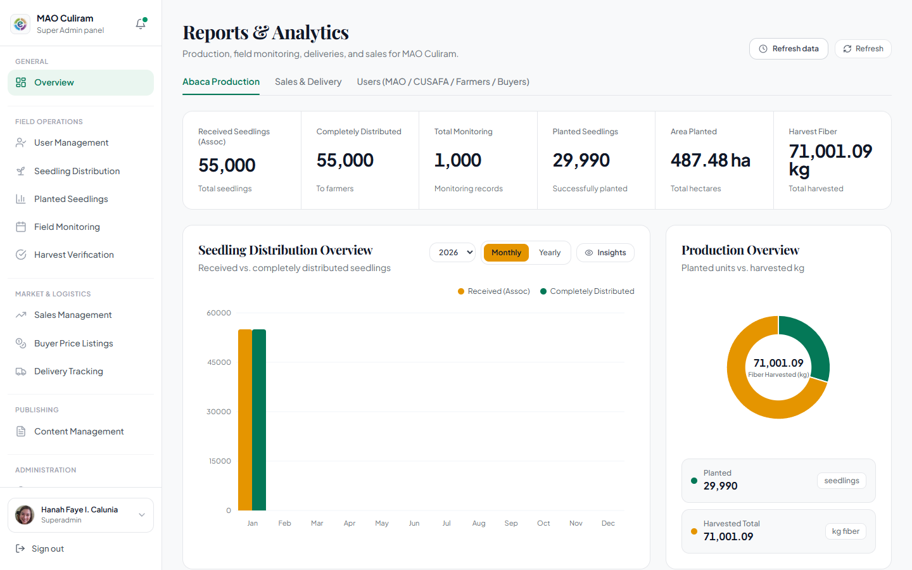

- **Tabs:** *Abaca Production*, *Sales & Delivery*, *Users (MAO / CUSAFA / Farmers / Buyers)*.
- **Summary cards (Abaca Production):** Received Seedlings (Assoc), Completely Distributed, Total Monitoring, Planted Seedlings, Area Planted (ha), Harvest Fiber (kg).
- **Seedling Distribution Overview:** bar chart ng received vs. completely distributed. Piliin ang taon, at **Monthly** o **Yearly**. May **Insights** button.
- **Production Overview:** donut chart ng planted units vs. harvested kg.
- **Refresh data / Refresh:** i-reload ang pinakabagong data.

---

## 4. Field Operations

### 4.1 User Management
Pamahalaan ang accounts ng farmers, buyers at association coordinators.

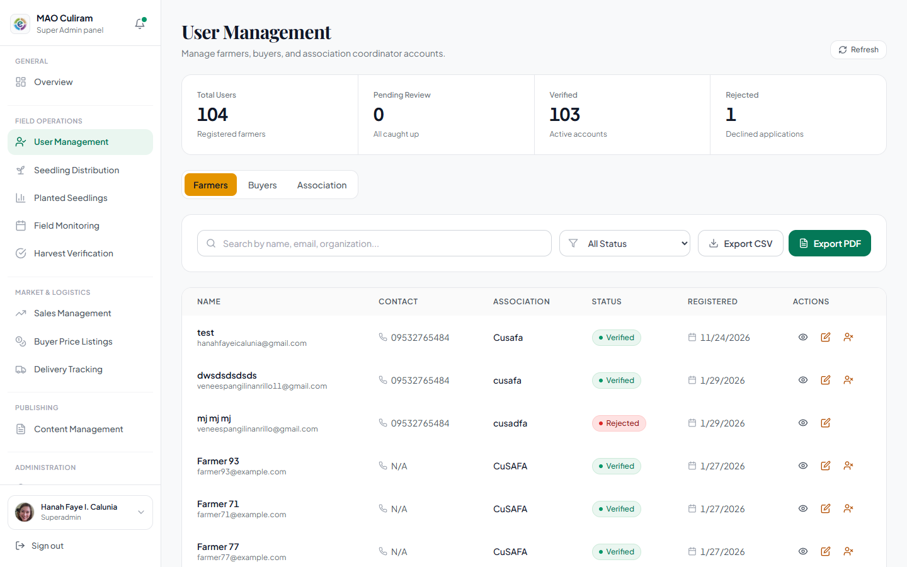

1. Piliin ang tab: **Farmers**, **Buyers**, o **Association**.
2. Gamitin ang search (pangalan, email, organization) at ang **All Status** filter.
3. Cards sa itaas: Total Users, Pending Review, Verified, Rejected.
4. Sa **Actions** column ng bawat user may icons: view (eye), edit (lapis), at isang account action icon. Ang naka-**Rejected** na user ay walang huling icon.
5. **Export CSV** o **Export PDF** para sa listahan.

> [!TIP]
> Ang **Pending Review** ang mga bagong rehistro na naghihintay ng verification. Kapag `0`, "All caught up".

### 4.2 Seedling Distribution
Subaybayan ang seedling batches na ibinigay sa associations.

- Cards: Total Distributions, Total Quantity, This Month, Varieties.
- Table columns: Photo, Date, Variety, Quantity, Recipient, Source, Status, Progress, Actions.
- **Distribute to Association** (berdeng button) – mag-record ng bagong distribution.
- Search, **All Status** filter at **Export**.

### 4.3 Planted Seedlings
Tingnan ang planting progress at area coverage ng mga farmers.

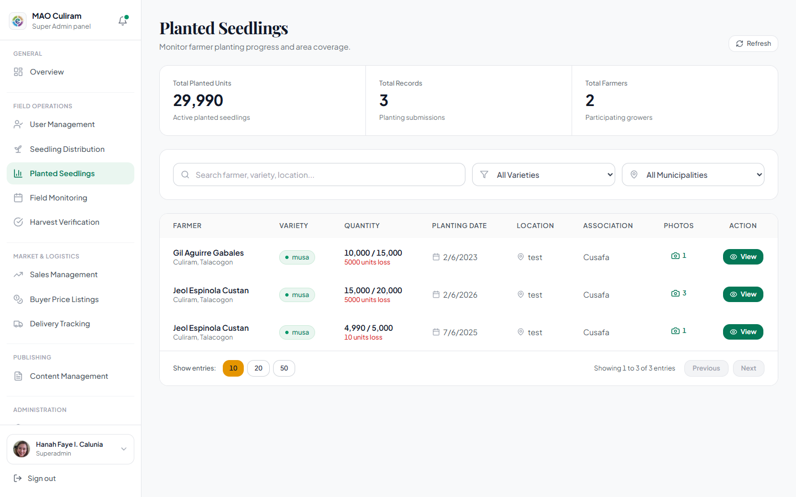

- Cards: Total Planted Units, Total Records, Total Farmers.
- Filters: search, **All Varieties**, **All Municipalities**.
- Columns: Farmer, Variety, Quantity (planted/received at ang "units loss"), Planting Date, Location, Association, Photos, Action.
- I-click ang **View** para makita ang detalye at photos.

### 4.4 Field Monitoring
Mga field visit logs at kondisyon ng bukid.

**Active tab (kasalukuyang mga monitoring):**

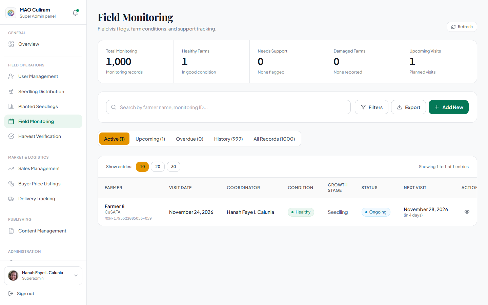

- Cards: Total Monitoring, Healthy Farms, Needs Support, Damaged Farms, Upcoming Visits.
- Mga tab: **Active**, **Upcoming**, **Overdue**, **History**, **All Records** (may bilang sa bawat isa).
- **Add New** – mag-simula ng bagong monitoring. **Filters** at **Export** ay nasa tabi nito.
- Bawat row: Farmer, Visit Date, Coordinator, Condition (*Healthy / Needs Support / Damaged*), Growth Stage, Status, Next Visit, Actions.

**History tab (tapos na na monitoring):**

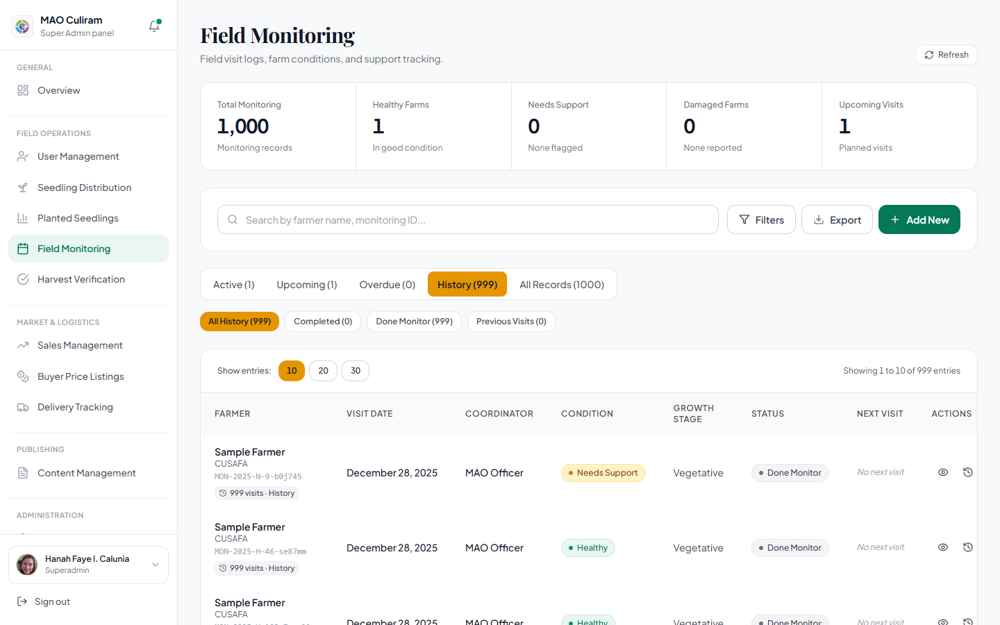

- Sub-filters: **All History**, **Completed**, **Done Monitor**, **Previous Visits**.
- Ang mga natapos na monitoring ay awtomatikong lumilipat sa **History** para malinis ang **Active** list.
- Ang `999 visits · History` chip at ang history icon sa Actions ay para makita ang lahat ng nakaraang visits ng farmer na iyon.

### 4.5 Harvest Verification
Suriin at i-verify ang harvest submissions ng farmers.

- Cards: Total Harvests, Total Farmers, Total Fiber (kg), Pending, Last 30 Days.
- Filter: search (farmer, location, variety) at status dropdown (default **Pending**). Palitan ang status para makita ang iba pang records.
- Kapag walang pending: "No harvests found". Subukang palitan ang filter.
- **Export CSV** para sa report.

---

## 5. Market & Logistics

### 5.1 Sales Management
Suriin, i-verify at pamahalaan ang sales reports ng farmers.

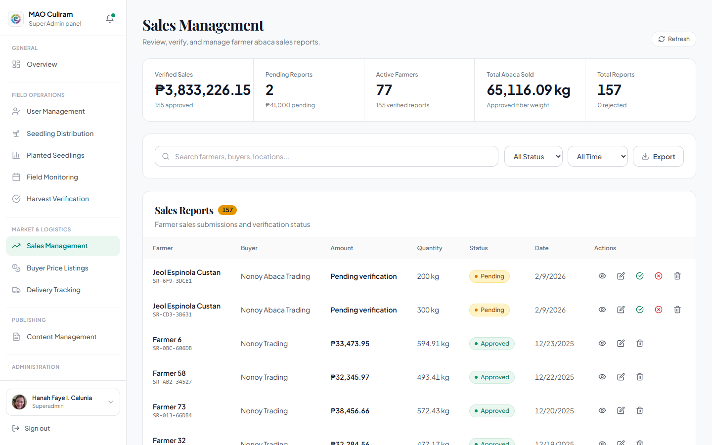

- Cards: Verified Sales, Pending Reports, Active Farmers, Total Abaca Sold, Total Reports.
- Filters: search, **All Status**, **All Time**, **Export**.
- Table: Farmer (may report code), Buyer, Amount, Quantity, Status (*Pending / Approved*), Date, Actions.
- Sa **Pending** rows, may mga icons para sa view, edit, **approve** (green check), **reject** (red x) at delete. Ang Approved rows ay view, edit at delete lang.

> [!IMPORTANT]
> Sa "Pending verification" na amount, i-verify muna ang report bago ito mabilang sa **Verified Sales**.

### 5.2 Buyer Price Listings
Ang kasalukuyang presyo ng mga buyers.

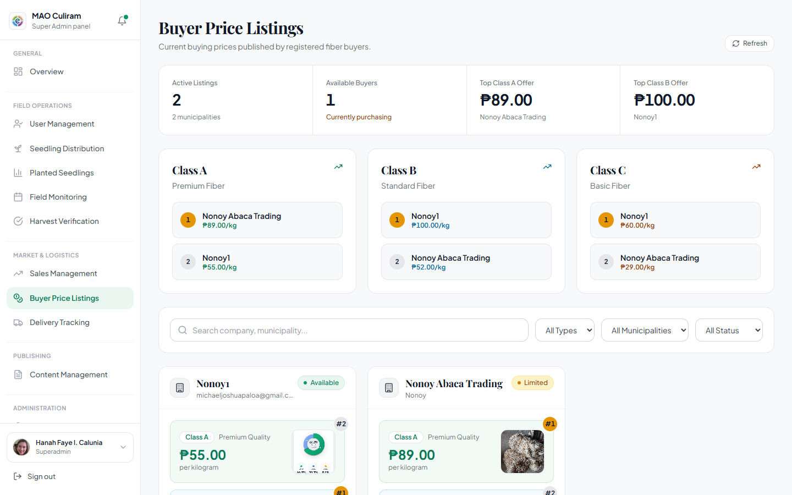

- Cards: Active Listings, Available Buyers, Top Class A Offer, Top Class B Offer.
- **Class A / B / C** ranking cards – nasa taas ang pinakamataas na presyo kada kg.
- Filters: search, **All Types**, **All Municipalities**, **All Status**.
- Sa ibaba ang mga buyer cards (Available / Limited) kasama ang presyo per kilogram.
- Read-only ang page na ito para sa admin; ang buyers ang nag-uupdate ng presyo.

### 5.3 Delivery Tracking
Subaybayan ang fiber deliveries sa buong associations.

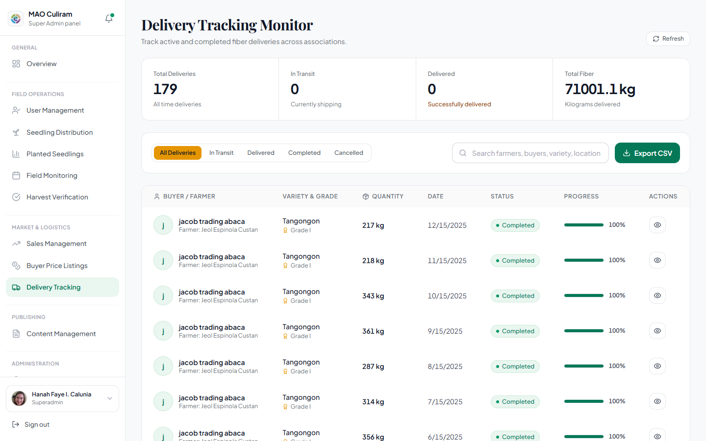

- Cards: Total Deliveries, In Transit, Delivered, Total Fiber (kg).
- Status tabs: **All Deliveries, In Transit, Delivered, Completed, Cancelled**.
- Table: Buyer / Farmer, Variety & Grade, Quantity, Date, Status, Progress, Actions (view).
- **Export CSV** at search (farmers, buyers, variety, location).

---

## 6. Administration (Super Admin lang)
Makikita lang ang section na ito ng **Super Admin**. Ang ibang coordinators ay hindi ito nakikita.

### Staff Management
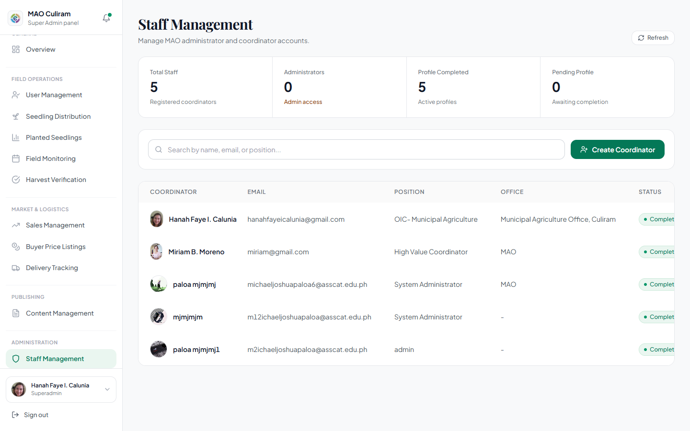

- Cards: Total Staff, Administrators, Profile Completed, Pending Profile.
- Table: Coordinator, Email, Position, Office, Status.
- **Create Coordinator** – gumawa ng bagong MAO admin/coordinator account.

## 7. Mga Action Buttons
Ito ang mga button na nagbubukas ng popup o form. Sa lahat ng popup, gamitin ang **X** sa kanang-taas (o **Cancel** / **Close**) para magsara nang walang binabago.

| Button / Icon | Saan makikita | Ginagawa |
|---|---|---|
| **Refresh** | Kanang-taas ng bawat page | Kumuha ng pinakabagong data |
| **Export / Export CSV / Export PDF** | User Mgmt, Seedling, Monitoring, Harvest, Sales, Delivery | I-download ang listahan |
| **Filters** | Field Monitoring | Magpakita ng dagdag na filters |
| **Add New** | Field Monitoring | Mag-record ng bagong monitoring |
| **Distribute to Association** | Seedling Distribution | Mag-record ng bagong distribution |
| **Create Coordinator** | Staff Management | Gumawa ng MAO coordinator account |
| 👁 View / **View** | Karamihan ng tables | Tingnan ang buong detalye |
| ✏ Edit | User, Seedling, Sales | Baguhin ang record |
| ✔ Approve / ✖ Reject | Sales (Pending rows lang) | I-verify o i-reject ang sales report |
| 🗑 Delete | Seedling, Sales | Burahin ang record |

### 7.1 Add New (Field Monitoring)
Pindutin ang **Add New** sa Field Monitoring para buksan ang **Field Monitoring Form**.

1. **Visit Information:** piliin ang **Date of Visit**. Ang **Monitored By** ay awtomatikong ang account mo.
2. **Farmer / Association Information:** piliin ang farmer sa **Select Farmer** (rehistradong farmers lang), ilagay ang **Association Name** at **Farm Location**.
3. **Crop Growth & Farm Condition:** piliin ang **Farm Condition** at **Growth Stage**, at ilagay ang **Weather Condition** at **Estimated Yield (kg)**.
4. I-save ang form sa ibaba ng popup. (Ang mga field na may pulang `*` ay kailangan.)

> [!NOTE]
> Ang bagong monitoring ay lalabas sa **Active** tab. Kapag tapos na, lilipat ito sa **History**.

### 7.2 Filters (Field Monitoring)
Pindutin ang **Filters** para magpakita ng **Farm Condition**, **Date From** at **Date To**. Pindutin ulit ang button para itago.

### 7.3 View (👁) sa Field Monitoring
Ipinapakita ang **Monitoring Details**: Basic Information (Monitoring ID, Date of Visit, Coordinator), Farmer Information, at Farm Assessment (condition, growth stage, weather, estimated yield, issues observed).

### 7.4 Distribute to Association (Seedling Distribution)
Pindutin ang berdeng **Distribute to Association** button.

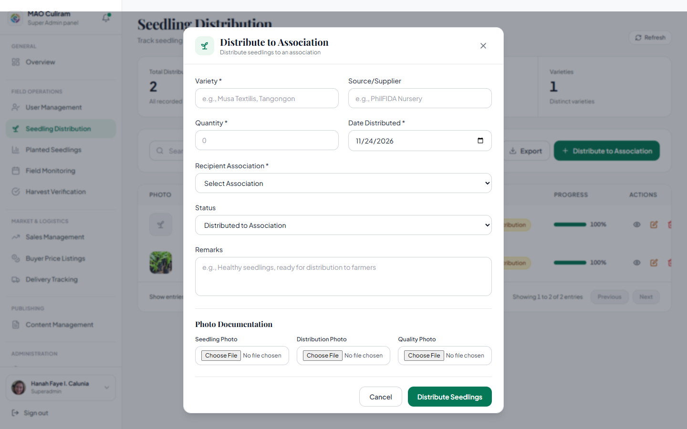

1. Ilagay ang **Variety**, **Quantity** at **Date Distributed**. Opsyonal ang **Source/Supplier**.
2. Piliin ang **Recipient Association** at ang **Status**.
3. Maglagay ng **Remarks** (opsyonal) at mag-upload ng **Photo Documentation** (Seedling, Distribution at Quality Photo).
4. Pindutin ang **Distribute Seedlings** para i-save, o **Cancel** para umatras.

### 7.5 View (👁) sa Seedling Distribution
Ipinapakita ang **Distribution Details** (variety, quantity, petsa, recipient, status, remarks) at ang **Distribution Progress**: Total, Distributed at Remaining.

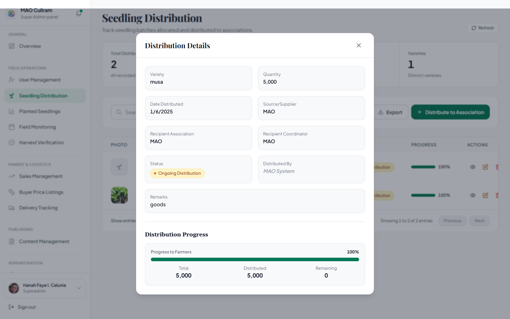

### 7.6 View sa Planted Seedlings
Ipinapakita ang **Planting Details**: farmer, Seedling Information (variety, quantity distributed, actual planted, damaged/losses), petsa, lokasyon, method, at **Planting Photos**.

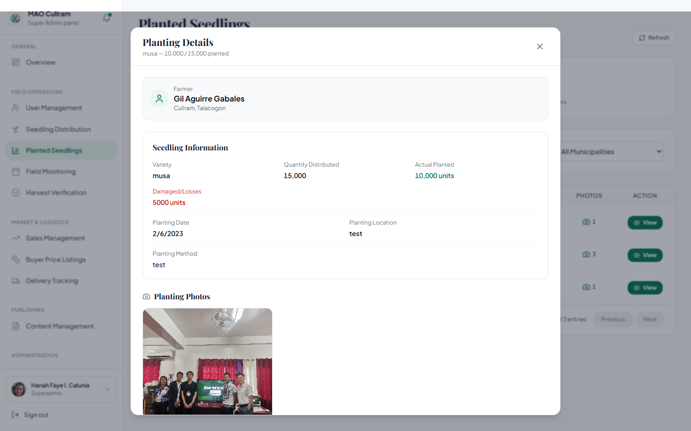

### 7.7 View (👁) sa Sales Management
Ipinapakita ang **Sales Report Details**: Report ID, Farmer, Buyer Company, Total Sales, Quantity Sold, Status at Submitted Date. Pindutin ang **Close** para isara.

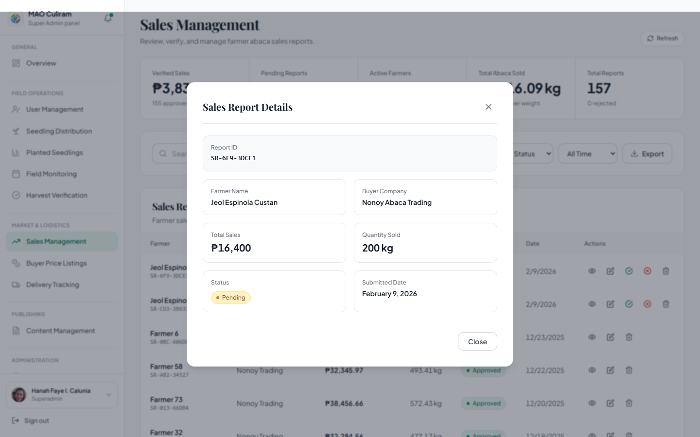

> [!IMPORTANT]
> Ang ✔ (approve) at ✖ (reject) ay para sa **Pending** na reports lang. Suriing mabuti ang detalye bago pumili.

### 7.8 Create Coordinator (Staff Management)
Pindutin ang **Create Coordinator** para buksan ang **Create Coordinator Account**.

1. Ilagay ang **Full Name** at **Email Address**.
2. Maglagay ng **Password** (minimum 8 characters) at ulitin sa **Confirm Password**.
3. I-check ang **Make this account a Super Admin** *kung* kailangan ng buong access (kasama ang pag-create ng accounts at maintenance mode). Iwanang hindi naka-check para sa regular coordinator.
4. Pindutin ang **Create Account**, o **Cancel** para umatras.

> [!WARNING]
> Ibigay lang ang Super Admin sa mga pinagkakatiwalaang tauhan.

---

## 8. Tips at Troubleshooting
- **Matagal mag-load / spinner:** hintayin ang unang load. Ang data ay naka-cache, kaya mabilis na ang mga susunod na pagbalik sa page. Pindutin ang **Refresh** kung kailangan ng pinakabagong data.
- **Walang lumalabas na data:** tingnan ang search box at mga filters (status, municipality, variety), baka naka-filter.
- **Hindi makapag-login:** i-check ang email/password. Kung may "Login failed", subukan ulit at siguraduhing may internet para sa reCAPTCHA.
- **Hindi makita ang Administration section:** hindi Super Admin ang account.
- **Seguridad:** mag-**Sign out** pagkatapos gumamit, lalo sa shared na computer. Huwag ibahagi ang password.
