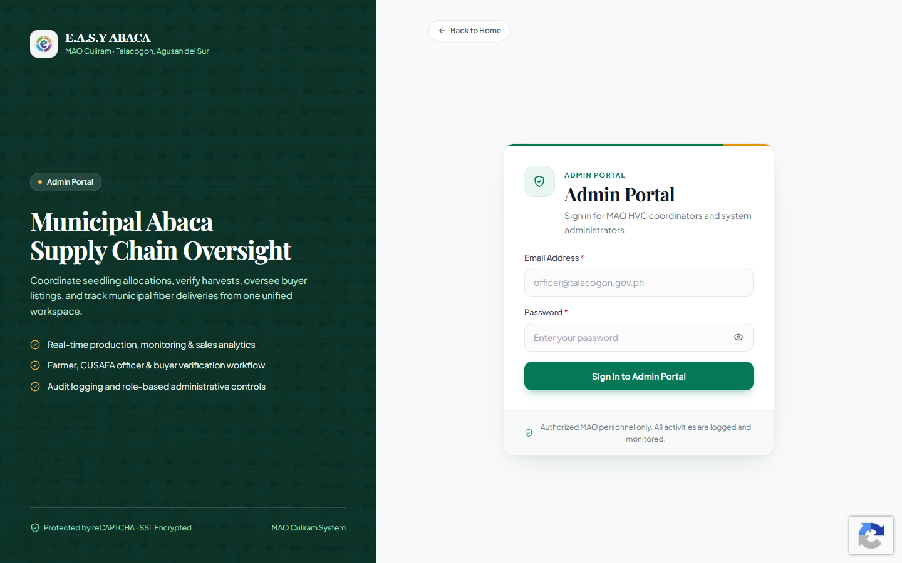
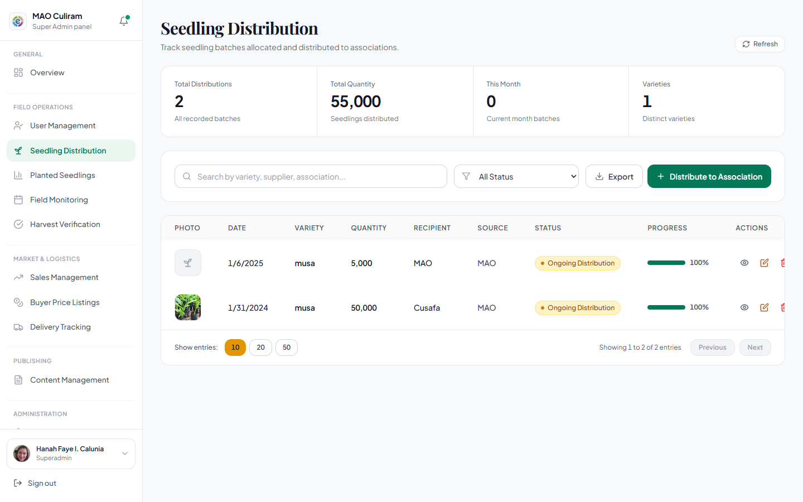
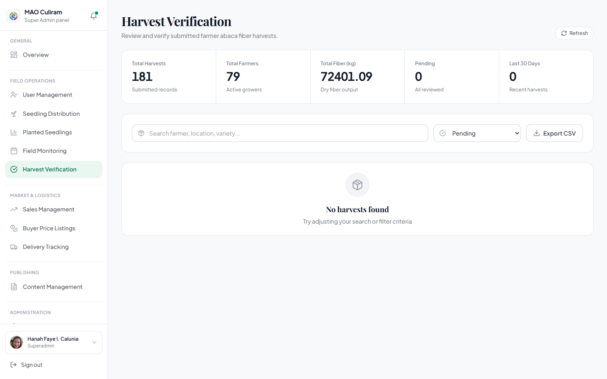
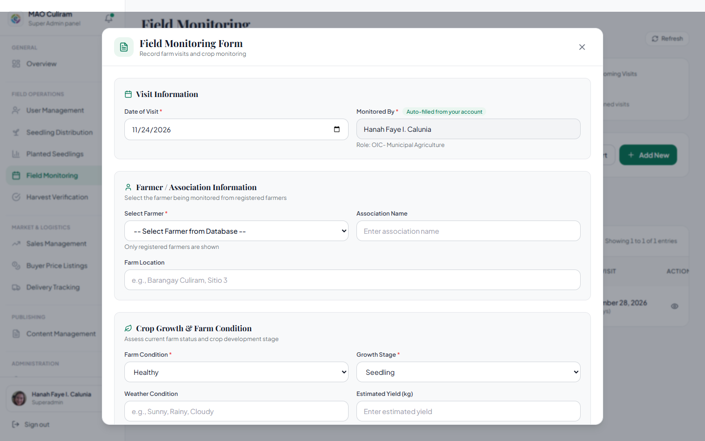
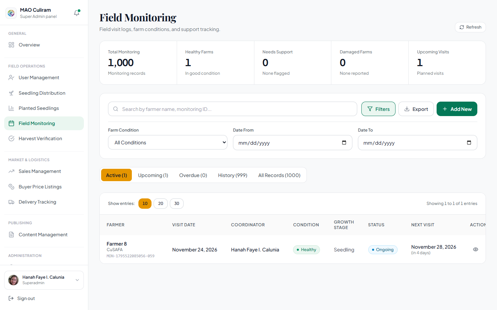
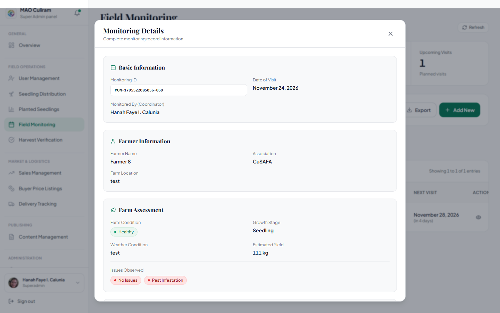
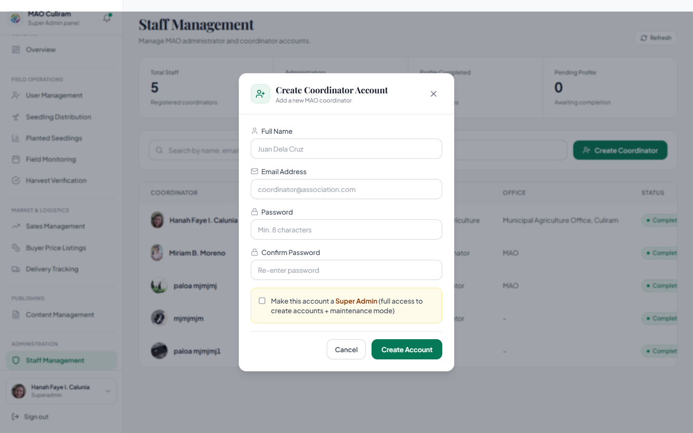

# E.A.S.Y ABACA – Admin (MAO) User Manual

For **MAO Super Admins / Coordinators** of MAO Culiram. All screenshots are taken directly from the Admin Portal (`/mao`).

> [!NOTE]
> Numbers and names shown in screenshots reflect live system data at capture time and will change as new records are added.

## Table of Contents
1. [Sign In](#1-sign-in)
2. [Screen Overview](#2-screen-overview)
3. [Overview (Dashboard)](#3-overview-dashboard)
4. [Field Operations](#4-field-operations)
5. [Market & Logistics](#5-market--logistics)
6. [Administration (Super Admin Only)](#6-administration-super-admin-only)
7. [Action Buttons](#7-action-buttons)
8. [Tips & Troubleshooting](#8-tips--troubleshooting)

---

## 1. Sign In
1. Open `http://localhost:5173/mao` (in production: your site's `/mao` URL).
2. Enter your **Email Address** and **Password**.
3. Click **Sign In to Admin Portal**. This page is protected by reCAPTCHA.
4. Once signed in, you will land on **Overview**.

- **Back to Home** – return to the public homepage.
- Use the eye icon in the password field to show or hide your password.
- Only admin accounts can sign in here; farmers, buyers, and associations each have their own sign-in pages.

---

## 2. Screen Overview
The left sidebar groups pages by category:

| Category | Pages |
|---|---|
| **General** | Overview, User Manual |
| **Field Operations** | User Management, Seedling Distribution, Planted Seedlings, Field Monitoring, Harvest Verification |
| **Market & Logistics** | Sales Management, Buyer Price Listings, Delivery Tracking |
| **Administration** | Staff Management *(Super Admin only)* |

At the bottom of the sidebar are your profile card (name and role) and **Sign out**. The bell icon in the header opens notifications.

Each page includes a **Refresh** button in the top-right corner, summary cards at the top, search and filters in the middle, and data tables below. Use **Show entries** (10/20/30 or 50) to control how many rows appear per page.

---

## 3. Overview (Dashboard)
Title: **Reports & Analytics**. Provides a summary of production, field monitoring, deliveries, and sales.

- **Tabs:** *Abaca Production*, *Sales & Delivery*, *Users (MAO / CUSAFA / Farmers / Buyers)*.
- **Summary cards (Abaca Production):** Received Seedlings (Assoc), Completely Distributed, Total Monitoring, Planted Seedlings, Area Planted (ha), Harvest Fiber (kg).
- **Seedling Distribution Overview:** bar chart comparing received vs. completely distributed seedlings. Choose a year and toggle **Monthly** or **Yearly**. Includes an **Insights** button.
- **Production Overview:** donut chart comparing planted units vs. harvested kg.
- **Refresh data / Refresh:** reload the latest data.

---

## 4. Field Operations

### 4.1 User Management
Manage accounts for farmers, buyers, and association coordinators.

1. Select a tab: **Farmers**, **Buyers**, or **Association**.
2. Use search (name, email, organization) and the **All Status** filter.
3. Top cards: Total Users, Pending Review, Verified, Rejected.
4. Each row's **Actions** column includes icons to view (eye), edit (pencil), and perform an account action. **Rejected** users do not show the final icon.
5. Click **Export CSV** or **Export PDF** to download the list.

> [!TIP]
> **Pending Review** shows new registrations waiting for verification. When `0`, everything is "All caught up".

### 4.2 Seedling Distribution
Track seedling batches distributed to associations.

- Cards: Total Distributions, Total Quantity, This Month, Varieties.
- Table columns: Photo, Date, Variety, Quantity, Recipient, Source, Status, Progress, Actions.
- **Distribute to Association** (green button) – record a new distribution.
- Includes search, **All Status** filter, and **Export**.

### 4.3 Planted Seedlings
View farmer planting progress and area coverage.

- Cards: Total Planted Units, Total Records, Total Farmers.
- Filters: search, **All Varieties**, **All Municipalities**.
- Columns: Farmer, Variety, Quantity (planted/received and "units loss"), Planting Date, Location, Association, Photos, Action.
- Click **View** to inspect full planting details and photos.

### 4.4 Field Monitoring
Field visit logs and farm condition reports.

**Active tab (ongoing monitoring):**

- Cards: Total Monitoring, Healthy Farms, Needs Support, Damaged Farms, Upcoming Visits.
- Tabs: **Active**, **Upcoming**, **Overdue**, **History**, **All Records** (with counts on each tab).
- **Add New** – create a new monitoring record. **Filters** and **Export** sit beside it.
- Each row shows: Farmer, Visit Date, Coordinator, Condition (*Healthy / Needs Support / Damaged*), Growth Stage, Status, Next Visit, Actions.

**History tab (completed monitoring):**

- Sub-filters: **All History**, **Completed**, **Done Monitor**, **Previous Visits**.
- Completed monitoring records move to **History** automatically to keep the **Active** list uncluttered.
- The `visits · History` chip and the history icon in Actions show all prior visits for that farmer.

### 4.5 Harvest Verification
Review and verify abaca harvest submissions from farmers.

- Cards: Total Harvests, Total Farmers, Total Fiber (kg), Pending, Last 30 Days.
- Filters: search (farmer, location, variety) and status dropdown (defaults to **Pending**). Change the status to view other records.
- If no pending records exist, "No harvests found" is shown; adjust the filter to view verified or rejected entries.
- Click **Export CSV** to download a report.

---

## 5. Market & Logistics

### 5.1 Sales Management
Review, verify, and manage farmer sales reports.

- Cards: Verified Sales, Pending Reports, Active Farmers, Total Abaca Sold, Total Reports.
- Filters: search, **All Status**, **All Time**, **Export**.
- Table: Farmer (with report code), Buyer, Amount, Quantity, Status (*Pending / Approved*), Date, Actions.
- **Pending** rows include icons to view, edit, **approve** (green check), **reject** (red x), and delete. Approved rows offer view, edit, and delete only.

> [!IMPORTANT]
> Reports with "Pending verification" amounts must be verified before they count toward **Verified Sales**.

### 5.2 Buyer Price Listings
Current abaca buying prices published by buyers.

- Cards: Active Listings, Available Buyers, Top Class A Offer, Top Class B Offer.
- **Class A / B / C** ranking cards – highest prices per kg appear at the top.
- Filters: search, **All Types**, **All Municipalities**, **All Status**.
- Buyer cards below show availability (*Available / Limited*) and prices per kilogram.
- This page is read-only for admins; buyers manage their own listings.

### 5.3 Delivery Tracking
Track fiber deliveries across associations.

- Cards: Total Deliveries, In Transit, Delivered, Total Fiber (kg).
- Status tabs: **All Deliveries, In Transit, Delivered, Completed, Cancelled**.
- Table: Buyer / Farmer, Variety & Grade, Quantity, Date, Status, Progress, Actions (view).
- Includes **Export CSV** and search (farmers, buyers, variety, location).

---

## 6. Administration (Super Admin Only)
Visible only to **Super Admin** accounts. Regular coordinators do not see this section.

### Staff Management

- Cards: Total Staff, Administrators, Profile Completed, Pending Profile.
- Table: Coordinator, Email, Position, Office, Status.
- **Create Coordinator** – create a new MAO admin or coordinator account.

## 7. Action Buttons
These buttons open forms or detail modals. In every modal, click **X** at the top-right (or **Cancel** / **Close**) to exit without saving changes.

| Button / Icon | Location | Action |
|---|---|---|
| **Refresh** | Top-right of every page | Reload the latest data |
| **Export / Export CSV / Export PDF** | User Mgmt, Seedling, Monitoring, Harvest, Sales, Delivery | Download the list |
| **Filters** | Field Monitoring | Show or hide extra filters |
| **Add New** | Field Monitoring | Record a new monitoring visit |
| **Distribute to Association** | Seedling Distribution | Record a new distribution |
| **Create Coordinator** | Staff Management | Create a MAO coordinator account |
| 👁 View / **View** | Most tables | Inspect complete record details |
| ✏ Edit | User, Seedling, Sales | Edit the record |
| ✔ Approve / ✖ Reject | Sales (Pending rows only) | Verify or reject a sales report |
| 🗑 Delete | Seedling, Sales | Delete the record |

### 7.1 Add New (Field Monitoring)
Click **Add New** in Field Monitoring to open the **Field Monitoring Form**.

1. **Visit Information:** select **Date of Visit**. **Monitored By** is filled automatically with your account.
2. **Farmer / Association Information:** choose a registered farmer in **Select Farmer**, then fill in **Association Name** and **Farm Location**.
3. **Crop Growth & Farm Condition:** set **Farm Condition**, **Growth Stage**, **Weather Condition**, and **Estimated Yield (kg)**.
4. Save the form at the bottom of the popup. (Fields with a red `*` are required.)

> [!NOTE]
> New monitoring records appear in the **Active** tab and automatically move to **History** once completed.

### 7.2 Filters (Field Monitoring)
Click **Filters** to show **Farm Condition**, **Date From**, and **Date To**. Click again to hide them.

### 7.3 View (👁) in Field Monitoring
Opens **Monitoring Details**: Basic Information (Monitoring ID, Date of Visit, Coordinator), Farmer Information, and Farm Assessment (condition, growth stage, weather, estimated yield, issues observed).

### 7.4 Distribute to Association (Seedling Distribution)
Click the green **Distribute to Association** button.

1. Enter **Variety**, **Quantity**, and **Date Distributed**. **Source/Supplier** is optional.
2. Select **Recipient Association** and **Status**.
3. Add optional **Remarks** and upload **Photo Documentation** (Seedling, Distribution, and Quality photos).
4. Click **Distribute Seedlings** to save, or **Cancel** to go back.

### 7.5 View (👁) in Seedling Distribution
Shows **Distribution Details** (variety, quantity, date, recipient, status, remarks) and **Distribution Progress**: Total, Distributed, and Remaining.

### 7.6 View in Planted Seedlings
Shows **Planting Details**: farmer, Seedling Information (variety, quantity distributed, actual planted, damaged/losses), date, location, method, and **Planting Photos**.

### 7.7 View (👁) in Sales Management
Shows **Sales Report Details**: Report ID, Farmer, Buyer Company, Total Sales, Quantity Sold, Status, and Submitted Date. Click **Close** to dismiss.

> [!IMPORTANT]
> ✔ (approve) and ✖ (reject) apply only to **Pending** reports. Verify all details carefully before confirming.

### 7.8 Create Coordinator (Staff Management)
Click **Create Coordinator** to open **Create Coordinator Account**.

1. Enter **Full Name** and **Email Address**.
2. Enter a **Password** (minimum 8 characters) and repeat it in **Confirm Password**.
3. Check **Make this account a Super Admin** *only if* full access is needed (including account creation). Leave unchecked for regular coordinators.
4. Click **Create Account**, or **Cancel** to go back.

> [!WARNING]
> Only grant Super Admin privileges to trusted staff.

---

## 8. Tips & Troubleshooting
- **Slow initial load / spinner:** wait for the first load to complete. Responses are cached so switching pages afterwards is fast. Click **Refresh** anytime to fetch fresh data.
- **No data displayed:** check your search box and filters (status, municipality, variety) to make sure nothing is filtering out results.
- **Unable to sign in:** verify your email and password. If you see "Login failed", retry and confirm you have internet access for reCAPTCHA.
- **Administration section missing:** your account does not have Super Admin permissions.
- **Security:** always **Sign out** when finished, especially on shared computers, and never share your password.
